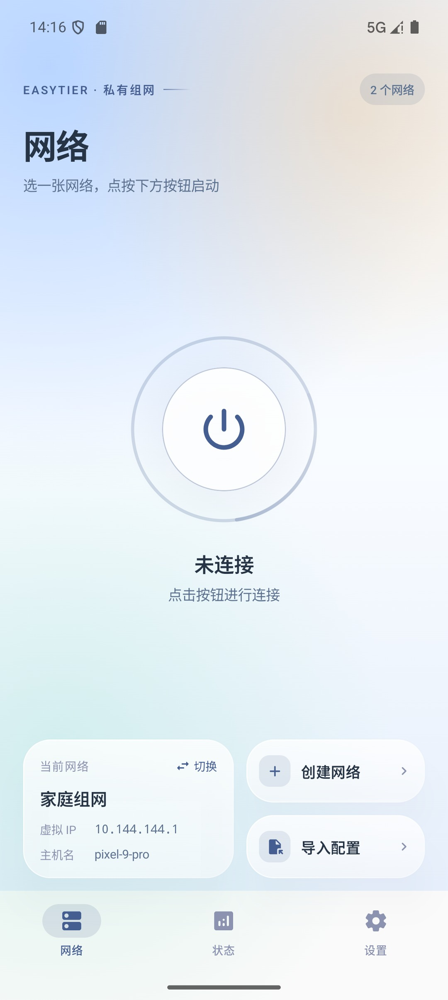
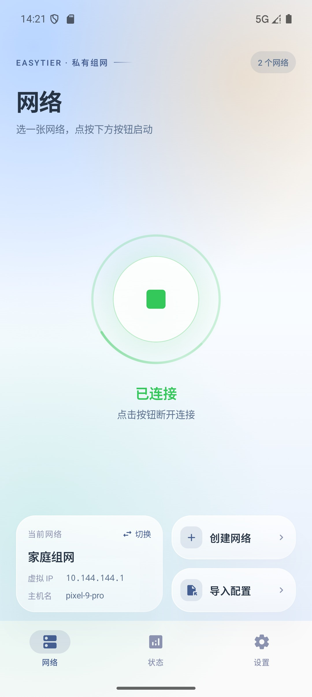
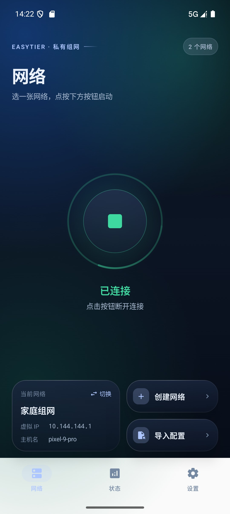
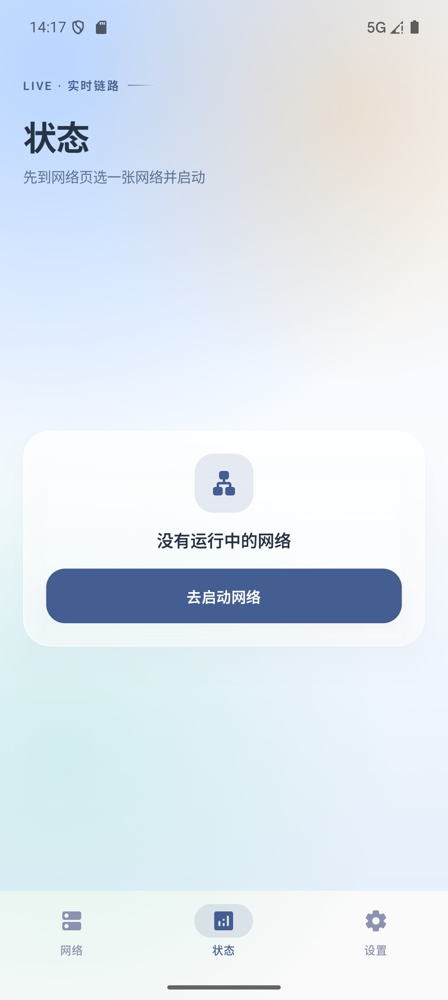
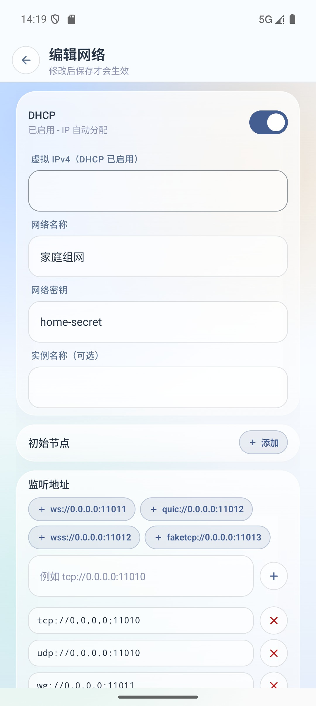
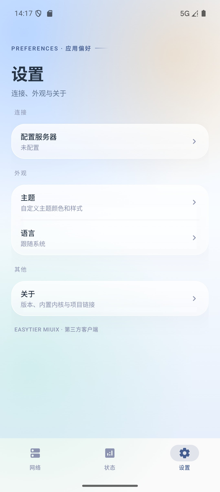

# EasyTier miuix

<div align="center">


EasyTier 的 Android 原生客户端，Kotlin + Jetpack Compose 构建，UI 采用 miuix 设计语言

[](LICENSE)
[](https://developer.android.com)
[](https://kotlinlang.org)
[](https://github.com/Lw-erpang/easytier-miuix/releases)

</div>

## 简介

EasyTier miuix 是 [EasyTier](https://github.com/EasyTier/EasyTier) 的第三方 Android 客户端，内置 EasyTier 2.7.0 核心（Rust / JNI，静态链接进单个 `.so`），提供网络配置管理、启停控制、运行状态监控与 VPN 服务。

界面基于 Jetpack Compose + [miuix](https://github.com/compose-miuix-ui/miuix) 组件库，并在此之上抽了一层自用的 **UI-Kit**（`ui/kit`）：统一色板、卡片 / 输入 / 对话框 / 顶栏等基础件与底部导航状态模型。目标是把「系统级工具的确定性」和「移动端的轻盈感」放在一起——浅色下是柔和的蓝绿点缀，深色下只保留点缀色，主体仍是深色玻璃层次。

## 截图

<div align="center">
<table>
<tr>
<td></td>
<td></td>
<td></td>
</tr>
<tr>
<td align="center">网络 · 未连接</td>
<td align="center">网络 · 已连接</td>
<td align="center">深色模式</td>
</tr>
<tr>
<td></td>
<td></td>
<td></td>
</tr>
<tr>
<td align="center">状态监控</td>
<td align="center">网络配置</td>
<td align="center">设置</td>
</tr>
</table>
</div>

## 功能

**网络管理**

- 创建、编辑、删除网络配置；支持多条网络并存，左下「当前网络」卡片整卡点击即可切换
- 导入配置文件：本应用导出的 JSON，或 easytier-gui / 命令行导出的 `config.toml`（只取本客户端支持的字段，其余忽略）
- 可配置项：DHCP / 静态虚拟 IP、主机名、网络名称与密钥、初始节点、监听地址（TCP / UDP / WG / QUIC / WS / WSS / FakeTCP 七种协议）、对外公布的映射地址、Proxy CIDR、出口节点、VPN Portal（含客户端白名单）、SOCKS5、端口转发、MTU、限速、加密与压缩算法，以及一批布尔开关（IPv6、KCP / QUIC 代理、P2P 策略、UPnP、Magic DNS 等）

**启停控制**

- 网络页中央的大圆电源按钮：外圈旋转弧 + 呼吸光晕，点击即启停；过渡态在内圈显示加载指示
- 状态语义跟随颜色：未连接为主色蓝，已连接为成功绿，与下方状态文字同源
- 快捷设置磁贴（Quick Settings Tile）可在通知栏直接开关

**运行监控**

- 实时上下行速率与流量曲线
- 对端列表：P2P / 中继标识、延迟、丢包，按连通质量排序
- 事件日志：人性化文本 + 级别过滤
- 运行中可直接重命名本机主机名（需要时自动重启网络生效）

**系统集成**

- 基于 Android `VpnService` 的前台服务承载 EasyTier 的 TUN 路由代理，支持随磁贴冷启动
- 配置服务器（easytier-web）：远程下发的网络由核心自动应用

**外观**

- Monet 动态取色、浅色 / 深色 / 跟随系统、20 色主题色板
- 模糊与透明效果；可选药丸形悬浮底栏（vibrancy + 高斯模糊 + 透镜折射）
- 中文 / English / 跟随系统

## 设计说明

界面刻意不做「控制台式」的密集堆叠：网络页只留一个动作（中央电源按钮）和两块信息（当前网络、创建 / 导入），其余收进二级页面；卡片、标签、信息行统一由 UI-Kit 提供，业务页面不直接书写尺寸与颜色常量。

UI-Kit 的两条硬规则（详见 `docs/UI_KIT_NAVIGATION.md` 与代码注释）：

1. **组件必须链式接管调用方的 `Modifier`**（`Row(modifier.then(styleModifier))`），否则父级的点击、内边距会静默失效；
2. **导航选中态只有一个数据源**（`NavTabState` 持有 `selectedId`），普通底栏与悬浮底栏共享同一份状态，切换形态不丢页。

## 技术栈

| 层 | 技术 |
|---|---|
| UI | Jetpack Compose（BOM 2025.05.00）+ miuix 0.9.3 |
| 语言 | Kotlin 2.3.21（JVM target 17） |
| 架构 | MVVM + Repository（StateFlow 单向数据流） |
| DI | Hilt 2.59.2 |
| 构建 | Gradle 9.6.0 + AGP 9.2.1 + KSP 2.3.9 |
| 存储 | DataStore（设置）+ 本地 JSON（网络配置） |
| 内核 | EasyTier 2.7.0 Rust 核心，JNI 静态链接 |
| 平台 | minSdk 32 / targetSdk 37 |

## 构建

### 环境要求

- JDK 17 及以上
- Android SDK 37（compileSdk / targetSdk）
- Rust + `cargo-ndk` + `protoc`（仅重新编译原生库时需要）

### 编译原生库

仓库已附带 `app/src/main/jniLibs/arm64-v8a/libeasytier_android_jni.so`，只改 UI 或业务逻辑不必重新编译。

需要更新内核时：

```bash
# 环境变量：ANDROID_NDK_ROOT、PROTOC
./build-native.sh        # Windows 用 build-native.ps1
```

脚本会拉取 EasyTier 源码到 `easytier-build/`，用 `cargo ndk` 编出 `aarch64-linux-android` 产物并拷进 `jniLibs`。核心已静态链接进该 `.so`（只导出 JNI 符号），无需单独的 `libeasytier_ffi.so`。

> 「关于」页显示的内核版本在构建时从 `easytier-build/easytier/Cargo.toml` 读取；干净克隆（没有该目录）会降级显示 `unknown`，不影响功能。

### 构建 APK

```bash
./gradlew assembleDebug     # Debug
./gradlew assembleRelease   # Release
```

Release 签名读根目录的 `keystore.properties`：

```properties
storeFile=easytier-release.jks
storePassword=<your_password>
keyAlias=<your_alias>
keyPassword=<your_password>
```

### 已知限制

- 原生库只提供 `arm64-v8a`，x86_64 模拟器可以打开界面，但启动网络会报 “Native library not loaded”，连通性请用真机验证。

## 项目结构

```
app/src/main/java/
├── com/easytier/jni/
│   └── EasyTierJNI.kt              # JNI 绑定（对齐上游 android-jni 接口）
└── top/easytier/miuix/
    ├── MainActivity.kt             # 入口 Activity
    ├── EasyTierApp.kt              # Hilt Application
    ├── data/
    │   ├── model/                  # NetworkConfig / ConfigImporter / PeerInfo / PeerClassifier
    │   └── repository/             # NetworkRepository 接口 + RealNetworkRepository（TOML 生成、VPN、配置服务器）
    ├── di/AppModule.kt             # Hilt 绑定
    ├── jni/
    │   ├── EasyTierVpnService.kt   # VPN 前台服务
    │   ├── EasyTierTileService.kt  # 快捷设置磁贴
    │   └── EasyTierManager.kt      # 网络生命周期管理
    └── ui/
        ├── AppNavigation.kt        # 主导航（底栏两形态 + 返回手势）
        ├── kit/                    # UI-Kit：theme/Palette、KitTheme、components、navigation/NavTabs
        ├── components/             # FloatingBottomBar、TrafficChart、ListenerPicker、PortForwardEditor、液态玻璃（liquid/）
        ├── screens/                # networks / status / config / settings
        ├── dialogs/                # 关于、配置服务器、语言切换
        └── theme/                  # AppSettings、ColorMode、Colors、Theme
```

## 发布

版本说明按 tag 归档在 `scripts/release-notes/<tag>.md`，构建产物（APK）作为 Release 附件分发，不进 git 历史。

## 致谢

- [EasyTier](https://github.com/EasyTier/EasyTier) — 核心网络引擎
- [qingkong9579/easytier-miuix](https://github.com/qingkong9579/easytier-miuix) — 本项目的上游客户端，本项目在其基础上继续开发
- [miuix](https://github.com/compose-miuix-ui/miuix) — Compose 组件库
- [SukiSU-Ultra](https://github.com/SukiSU-Ultra/SukiSU-Ultra) — 液态玻璃效果参考
- [AndroidLiquidGlass](https://github.com/Kyant0/AndroidLiquidGlass) — 透镜折射着色器
- [ui-skills](https://www.ui-skills.com/) — UI 设计工程规范参考

## 许可证

本项目基于 [Apache License 2.0](LICENSE) 开源。EasyTier 核心遵循其上游许可证。
